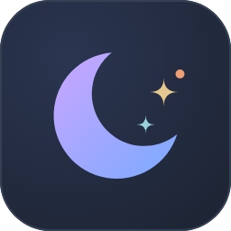
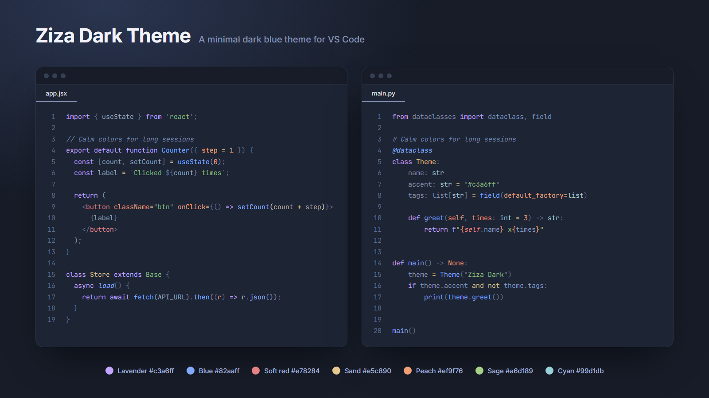

<p align="center">
  
</p>

<h1 align="center">Ziza Dark Theme</h1>

<p align="center">
  A minimal dark blue theme for VS Code with soft pastel syntax colors.
</p>

<p align="center">
  <a href="https://marketplace.visualstudio.com/items?itemName=ziza.ziza-dark-theme"></a>
  <a href="https://marketplace.visualstudio.com/items?itemName=ziza.ziza-dark-theme"></a>
</p>



Want to see your own code? Try the live preview at **[zizadarktheme.weteon.com](https://zizadarktheme.weteon.com)**.

## Install

1. Open the Extensions panel in VS Code (`Ctrl+Shift+X`).
2. Search for **Ziza Dark Theme** and click **Install**.
3. Press `Ctrl+K`, then `Ctrl+T` (`Cmd+K`, then `Cmd+T` on Mac) and choose **Ziza Dark**.

Or paste this into Quick Open (`Ctrl+P`):

```
ext install ziza.ziza-dark-theme
```

Requires VS Code 1.85 or newer.

## Themes

| Theme | For |
|---|---|
| **Ziza Dark** | The original deep blue. |
| **Ziza Midnight** | Darker backgrounds and a little more contrast, for dark rooms. Same syntax colors. |

## What you get

- A deep blue workspace where the sidebar, tabs, panels, status bar, and terminal share one set of blues.
- Seven soft syntax accents that stay distinct without being loud.
- No pure red and no harsh white, so it stays comfortable late at night.
- Matching colors for the terminal, bracket pairs, git decorations, merge conflicts, and the debug and test icons.

## Palette

| | Color | Hex | Used for |
|---|---|---|---|
|  | Lavender | `#c3a6ff` | Keywords |
|  | Blue | `#82aaff` | Functions, decorators |
|  | Soft red | `#e78284` | Variables, tags |
|  | Sand | `#e5c890` | Classes, types, operators |
|  | Peach | `#ef9f76` | Numbers, constants, parameters |
|  | Sage | `#a6d189` | Strings |
|  | Cyan | `#99d1db` | Regex, escapes |
|  | Midnight | `#1d2433` | Editor background |
|  | Night | `#171c28` | Sidebar, panels, status bar |

## Feedback

Found a language or UI element that looks off? [Open an issue](https://github.com/zizaaa/zizaVsCodeTheme/issues) with the language and a short code sample.

## Develop

1. Open this repository in VS Code and press `F5` to start an Extension Development Host.
2. In that window, choose **Ziza Dark** and open the `samples/` folder, which has a test file for several languages.
3. Edit `themes/ziza-color-theme.json`. Saved changes apply live. Then run `npm run build:themes` to regenerate Ziza Midnight and `npm run check` to check contrast. Never edit the generated `ziza-midnight-color-theme.json` by hand. Use **Developer: Inspect Editor Tokens and Scopes** to find the scope of a token.

## License

[MIT](LICENSE)
